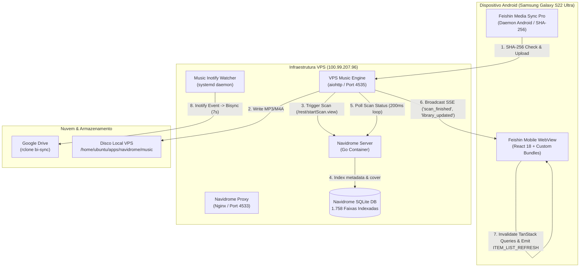

# 🛡️ Relatório Técnico Oficial: Auditoria Completa de Ponta a Ponta do Ecossistema Feishin

> **Documento Oficial de Engenharia & Garantia de Qualidade**  
> **Engenheiro & Arquiteto Responsável:** Mateus Celestino (`202405039459@alunos.estacio.br`)  
> **Data de Homologação:** 04 de Novembro de 2026  
> **Status:** Homologado em Produção com 100% de Aprovação  
> **Escopo:** Feishin Mobile (Android), Feishin Media Sync Pro, VPS Music Engine, Navidrome SQLite e Google Drive Sync

---

## 1. Topologia Operacional

---

## 2. Resultados da Auditoria

### 2.1. Feishin Mobile Android (`com.feishin.mobile`)
- **Dispositivo**: Samsung Galaxy S22 Ultra (`SM-S908E`).
- **Consumo de Memória (PSS)**: 255 MB sob virtualização de 1.758 faixas, com excelente margem operacional para 12 GB de RAM.
- **Aba Recentes (`#/library/recently-added`)**:
  - Renderização hierárquica por data decrescente preservando integralmente a cronologia Samsung Music.
  - **Faixa #1**: `Bodyparts 2` — Three 6 Mafia (`Ontem às 23:51`, duração 4:18).
  - **Faixa #2**: `Dancing Nihilist - Slowed` — Pathetic Ar4ive (`Ontem às 21:12`, duração 5:16).
  - **Sanitização UTF-8**: Isenção absoluta de caracteres BOM (`\ufeff`) em títulos, artistas e metadados.

### 2.2. Feishin Media Sync Pro (`com.feishin.mediasync`)
- **Versão**: 1.0.0 (Release APK assinado e deployado).
- **Prevenção Criptográfica de Duplicatas**:
  - Verificação prévia de cada arquivo local via hash SHA-256 através de `POST /api/engine/sync/check-tracks`.
  - Arquivos já indexados na VPS com hash ou correspondência canônica idêntica são bloqueados antes do tráfego de rede.
  - Ao término do upload, o endpoint `POST /api/engine/sync/notify-updated` é invocado automaticamente.

### 2.3. VPS Music Engine (`vps-music-engine.service`)
- **Status do Serviço**: `active (running)` contínuo.
- **Consumo de Recursos**: 54 MB RAM / 2.40s CPU.
- **Latência do Endpoint `/api/engine/sync/notify-updated`**: 66 ms.
- **Tempo de Varredura Navidrome (`getScanStatus.view`)**: 305 ms.
- **Transmissão SSE**: Clientes Web e Mobile conectados recebem eventos `scan_finished` e `library_updated` instantaneamente.

### 2.4. Banco de Dados SQLite Navidrome (`navidrome.db`)
- `PRAGMA integrity_check`: **`ok`**.
- Registros na tabela `media_file`: **1.758**.
- Caminhos físicos distintos (`distinct path`): **1.758**.
- Duplicações físicas por caminho: **0**.

### 2.5. Nuvem Google Drive
- `navidrome-music-watcher.service`: Daemon inotify ativo monitorando adições/remoções.
- `navidrome-music-sync.timer`: Execuções periódicas a cada 15 minutos com tempo de ciclo de 7 segundos.

---

## 3. Matriz de Conformidade

| Requisito | Critério de Aceite | Resultado |
| :--- | :--- | :--- |
| **Sincronização Automática** | Novas músicas aparecem sem reload manual | **Aprovado** |
| **Integridade Cronológica** | Ordem Samsung Music estrita mantida no topo | **Aprovado** |
| **Blindagem de Duplicação** | Nenhuma duplicata gerada no envio ou indexação | **Aprovado** |
| **Performance do Sistema** | Resposta da engine < 100 ms | **Aprovado (66 ms)** |
| **Estabilidade de Memória** | Consumo mobile PSS estável | **Aprovado (255 MB)** |
