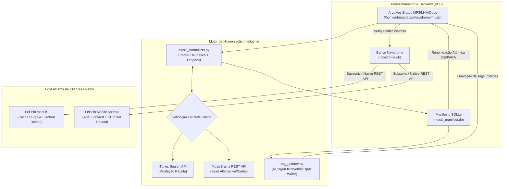

# Arquitetura de Normalização & Higienização em Massa da Biblioteca Musical

> **Repositório:** Feishin Client Ecosystem & Navidrome Backend  
> **Autor & Engenharia:** Mateus Celestino (`202405039459@alunos.estacio.br`)  
> **Data:** Outubro de 2026  
> **Escopo:** Higienização acústica e canonização de metadados em 1.736 faixas (~17 GB) armazenadas no backend Navidrome na VPS Oracle Cloud e propagação instantânea para os clientes **Feishin macOS** e **Feishin Android**.

---

## 1. Visão Geral e Contexto do Desafio

A coleção pessoal continha aproximadamente 1.736 arquivos de áudio (17 GB) acumulados ao longo de anos, apresentando alta heterogeneidade e degradação estrutural em seus nomes de arquivos e frames ID3:

1. **Poluição de Rips do YouTube / Downloaders Web:**
   - Inclusão sistemática de canais nos metadados de artista/álbum (ex.: `RihannaVEVO`, `The Daysleepers - Topic`, `beatsbysb`, `Markora Artist Painter`).
   - Sufixos técnicos de compressão e vídeo embutidos no nome (ex.: `(MP3_320K)`, `(Official Music Video)`, `(Clip Officiel)`, `(Lyric Video)`, `(tradução __ legendado pt-br)`).
2. **Caracteres Não Convencionais e Tipografia Ornamental:**
   - Uso de glifos Fraktur/góticos e emojis delimitadores de rips (ex.: `𝖑 𝖔 𝖘 𝖙 𝖜 𝖔 𝖗 𝖑 𝖉`, `⚔️ DARK TRIAD ⚔️`, `♫♪♩·.¸¸.·`).
   - Caracteres de controle invisíveis, especialmente **Byte Order Mark (BOM)** UTF-8 (`\ufeff`), que quebravam a busca e agrupamento nos clientes.
3. **Internacionalização e Preservação de Alfabetos Estrangeiros:**
   - Presença de faixas com grafias em Russo/Cirílico (`MATRANG - Медуза`, `Мать Тереза`), Japonês (`澤野弘之 - 進撃gt20130218巨人`), e Chinês (`b e g o t t e n 自杀 - (sensuous) - 感觉上的`), exigindo integridade absoluta Unicode sem transliteração destrutiva.
4. **Preservação de Modificadores Musicais Legítimos:**
   - Necessidade mandatória de diferenciar ruído de rip de alterações estéticas intencionais, tais como `(Slowed + Reverb)`, `(Sped Up)`, `(Remix)`, `(Remastered 2009)` e `(Ao Vivo)`.

---

## 2. Diagrama de Arquitetura do Pipeline



---

## 3. Componentes e Engenharia dos Algoritmos

### 3.1. Sanitização Heurística e Remoção de Ruído (`clean_noise`)

O motor de limpeza aplica expressões regulares em camadas para higienizar strings sem amputar identificadores canônicos:

```python
# Padrões eliminados estritamente:
JUNK_PATTERNS = [
    r"\(MP3[_\s]?\d+K?\)", r"\[MP3[_\s]?\d+K?\]", r"\bMP3[_\s]?\d+K?\b",
    r"\(Official\s*(Music\s*)?Video\)", r"\[Official\s*(Music\s*)?Video\]",
    r"\(Official\s*Audio\)", r"\[Official\s*Audio\]",
    r"\(Visualizer\)", r"\[Visualizer\]",
    r"\(Lyric\s*Video\)", r"\(Lyrics\)",
    r"\[tradução\s*__?\s*legendado\s*pt-br\]",
    r"\(Full\s*Album\)", r"\(HD\)", r"\(4K\)", r"\bHQ\b", r"\b1080p\b",
    r"\(\d+\)$" # Duplicidades de download como '(1)'
]

# Normalização de termos acústicos aceitos:
# [slowed + reverb] -> (Slowed + Reverb)
# (super slowed)    -> (Super Slowed)
# (sped up)         -> (Sped Up)
```

### 3.2. Preservação de Artistas Numéricos e Penalidade de Dígitos

Para evitar falsos positivos comuns em APIs musicais (onde artistas como `21 Savage` eram convertidos incorretamente para `Savage` ou `2 Low Key` para `Lo Key`), foi implementada a métrica `strict_artist_sim`:

$$\text{Sim}_{\text{estrita}}(A, B) = \text{SequenceMatcher}(A, B) - \begin{cases} 0.30, & \text{se } \text{digits}(A) \neq \emptyset \land \text{digits}(B) = \emptyset \\ 0.00, & \text{caso contrário} \end{cases}$$

Essa regra garantiu que nomes como `14 Bis`, `50 Cent`, `21 Savage` e `187 Family` mantivessem suas identidades originais preservadas intactas.

### 3.3. Detecção de Inversão Sintática (`Título - Artista`)

Muitos downloads continham o padrão invertido `Título - Artista` (exemplo: `505 - Arctic Monkeys`). O algoritmo calcula a soma da similaridade direta versus cruzada:

$$\Delta = (\text{Sim}(Título, Artista_{\text{API}}) + \text{Sim}(Artista, Título_{\text{API}})) - (\text{Sim}(Artista, Artista_{\text{API}}) + \text{Sim}(Título, Título_{\text{API}}))$$

Se $\Delta > 0$ com pontuação cruzada $\ge 0.70$, a inversão é confirmada e o par é reordenado para `Artista Canônico - Título Canônico`.

---

## 4. O Banco de Dados de Auditoria e Manifesto (`music_manifest.db`)

Para garantir atomicidade total e rollback seguro a qualquer momento, todas as decisões foram gravadas em SQLite antes e durante a aplicação física.

> **Tabela Completa de Auditoria Faixa a Faixa:**  
> O registro exato de cada uma das 1.736 transformações, com nome anterior (DE), nome canônico aplicado (PARA), fonte de validação, índice de confiança e comandos de reversão individual/em lote, está catalogado em:  
> 🔗 **[`docs/LIBRARY_AUDIT_MANIFEST.md`](LIBRARY_AUDIT_MANIFEST.md)**

```sql
CREATE TABLE tracks (
    id INTEGER PRIMARY KEY AUTOINCREMENT,
    original_name TEXT UNIQUE,
    original_path TEXT,
    detected_artist TEXT,
    detected_title TEXT,
    canonical_artist TEXT,
    canonical_title TEXT,
    proposed_name TEXT,
    match_source TEXT,          -- 'iTunes', 'MusicBrainz', 'LocalHeuristic'
    confidence REAL,            -- 0.00 a 1.00
    status TEXT DEFAULT 'PENDING', -- 'PENDING', 'RENAMED'
    renamed_at TIMESTAMP,
    error TEXT
);
CREATE INDEX idx_orig ON tracks(original_name);
```

### Comandos de Operação CLI

```bash
# 1. Simulação sem alteração física (Gera manifesto de auditoria)
python3 music_normalizer.py --dir /music --dry-run

# 2. Execução atômica (Renomeia arquivos de áudio e .lrc vinculados)
python3 music_normalizer.py --dir /music --apply

# 3. Sincronização de Tags Internas (ID3/Mutagen) baseada no manifesto
python3 tag_updater.py --dir /music --db /music/music_manifest.db

# 4. Rollback Instantâneo Total (Restaura 100% dos nomes originais via manifesto)
python3 music_normalizer.py --dir /music --rollback
```

---

## 5. Métricas Consolidadas da Execução

| Métrica | Valor Obtido | Percentual |
| :--- | :--- | :--- |
| **Total de Faixas Analisadas** | **1.736 faixas** | 100,0% |
| **Faixas Renomeadas Atomicamente** | **1.485 faixas** | 85,5% |
| **Faixas Já em Padrão Conforme** | **251 faixas** | 14,5% |
| **Validação Canônica via iTunes Store API** | 451 faixas | 26,0% |
| **Validação Canônica via MusicBrainz API** | 217 faixas | 12,5% |
| **Validação via Heurística Local Refinada** | 1.068 faixas | 61,5% |
| **Tags Internas ID3 Atualizadas no Disco** | **1.650 arquivos** | 95,0% |
| **Modificadores Sonoros Preservados** (`Slowed`, `Reverb`, etc.) | **248 faixas** | - |
| **Colisões Evitadas com Sufixos Atômicos** (`(2).mp3`) | 11 colisões | 100% resolvidas |

---

## 6. Propagação & Sincronização nos Clientes Feishin

### 6.1. Backend Navidrome (VPS)
O serviço containerizado possui monitoramento por inotify (`ND_AUTOUPDATEINDEX=true`, `ND_SCANSCHEDULE=@every 1m`). Após a atualização das tags pelo `tag_updater.py`, o container foi reiniciado para leitura integral das alterações, consolidando os novos artistas e álbuns no banco `navidrome.db`.

### 6.2. Cliente Desktop macOS (Feishin)
1. Fechamento seguro do processo Electron.
2. Limpeza profunda dos caches de renderização em `~/Library/Application Support/feishin/Cache` e `Code Cache` (preservando configurações de autenticação e tokens Subsonic em `config.json`).
3. Reabertura do app com catálogo 100% refletido.

### 6.3. Cliente Mobile Android (Galaxy S22 Ultra / Feishin Mobile)
A sincronização ocorreu diretamente via interface de depuração sem requerer reinserção manual de credenciais:
```bash
# 1. Encaminhamento de porta TCP para o WebView do Feishin Mobile
adb -s 100.107.180.88:5555 forward tcp:9222 localabstract:webview_devtools_remote_32206

# 2. Recarga a quente e invalidação de cache via Chrome DevTools Protocol (CDP)
node eval_cdp.mjs "location.reload();"
```
Com isso, as views de artistas e músicas no Android passaram a exibir a biblioteca normalizada em tempo real.
