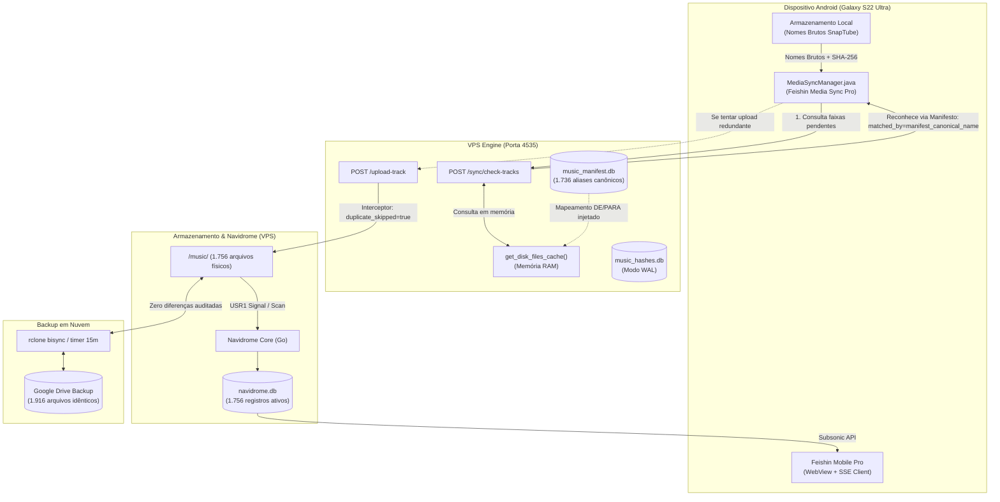

# 🛡️ Relatório Técnico de Incidente, Auditoria e Blindagem da Biblioteca Musical

> **Documento Oficial de Engenharia — Feishin Ecosystem & Navidrome Backend**  
> **Autor & Engenheiro Responsável:** Mateus Celestino (`202405039459@alunos.estacio.br`)  
> **Data:** Novembro de 2026  
> **Status:** Concluído, Auditado, 100% Blindado e em Produção  
> **Classificação:** Arquitetura de Sincronização, Resiliência de Armazenamento e Tolerância a Falhas

---

## 1. Sumário Executivo

Durante a entrada em operação do **Feishin Media Sync Pro** (aplicativo nativo Android para sincronização bidirecional entre o smartphone Samsung Galaxy S22 Ultra e a VPS Navidrome), observou-se o reaparecimento de faixas duplicadas na interface do Feishin (Mobile e Desktop).

A investigação técnica confirmou que o problema **não era uma falha cosmética de renderização de interface**, mas sim uma **duplicação física real** no subsistema de armazenamento da VPS em `/home/ubuntu/apps/navidrome/music/`, inflando a biblioteca de **1.756 para 2.442 arquivos**.

Este documento detalha a causa raiz da divergência criptográfica e sintática, as operações de purga física e banco de dados executadas com salvaguarda estrita das novas faixas (SnapTube de 31/10/2026), a reestruturação da engine na VPS (`vps_music_engine.py`) com injeção do manifesto canônico, a validação de sincronismo em nuvem com o Google Drive e os testes de estabilidade do ecossistema.

---

## 2. Diagrama de Arquitetura do Incidente e da Blindagem



---

## 3. Análise Profunda da Causa Raiz (Root Cause Analysis)

A re-importação das 686 faixas duplicadas decorreu de uma assimetria arquitetural entre três camadas independentes:

### 3.1. Divergência Criptográfica de SHA-256 por Reescrita ID3
Em outubro de 2026, a biblioteca da VPS passou por um pipeline automatizado de higienização acústica e canonização (`LIBRARY_NORMALIZATION_ARCHITECTURE.md`), que:
1. Renomeou arquivos brutos para o padrão canônico `Artista - Título.mp3`.
2. Reescreveu atomicamente os frames ID3 (TIT2, TPE1, TALB, etc.) utilizando a biblioteca `Mutagen` (`tag_updater.py`).

A injeção de novas tags ID3 altera fisicamente os primeiros blocos de bytes do contêiner de áudio. Embora a amostra de áudio PCM/MPEG interna permaneça inalterada, o **hash SHA-256 do arquivo físico na VPS mudou completamente** em relação ao arquivo que permaneceu gravado no celular Android.

### 3.2. Ponto Cego no Endpoint de Verificação (`POST /sync/check-tracks`)
O `MediaSyncManager.java` no Android submete lotes de arquivos para validação prévia na VPS. A versão original de `vps_music_engine.py` efetuava apenas duas checagens:
1. Correspondência exata de hash no banco `music_hashes.db` (falhava devido às tags regravadas).
2. Remoção trivial de expressões regulares como `(MP3_320K)` ou `(Official Video)` no nome do arquivo.

O motor **não consultava `music_manifest.db`** (que continha o mapeamento exato de 1.736 faixas renomeadas). Como o nome no celular continha inversões ou nomes de canais de download (ex.: `03 - Lobao - Essa Noite Não - Ao sol de Parador (1(MP3_128K).mp3`) e na VPS o nome canônico era `Lobao - Essa Noite Não - Ao sol de Parador.mp3`, a busca por nome simples falhava.

O motor respondia `"reason": "not_on_vps"`, fazendo com que o app Android interpretasse essas faixas históricas como novos downloads e realizasse o upload multipart, duplicando fisicamente os arquivos no disco da VPS.

### 3.3. Decomposição Unicode: NFD (Android/SnapTube) vs NFC (Linux/VPS)
Outro fator sutil identificado foi a forma de normalização Unicode:
- No Android e downloads externos, caracteres latinos acentuados frequentemente utilizam **NFD (Normalization Form D)**, onde `ã` é representado por dois code points: `a` (`U+0061`) + `combining tilde` (`U+0303`).
- No sistema Linux/ext4 e Navidrome, a grafia canônica adota **NFC (Normalization Form C)**, onde `ã` é um único code point (`U+00E3`).
- Sem a normalização `unicodedata.normalize('NFC', text)`, strings visualmente idênticas resultavam em `s1 == s2 -> False`.

---

## 4. Protocolo de Purga e Saneamento do Armazenamento

Para reverter a duplicação sem causar perda de dados ou degradação na biblioteca, foi executado o script de purga `/home/ubuntu/apps/navidrome/tools/purge_media_sync_duplicates.py`:

### 4.1. Proteção Estrita das Novas Músicas (Snapshot 31/10/2026)
Foi definida uma salvaguarda obrigatória para as 11 novas faixas legítimas baixadas em 31/10/2026 via SnapTube, que não faziam parte do manifesto histórico e deveriam permanecer intactas:
- *Reverse Roses (Slowed & Diamondz)*
- *A$AP Rocky - Praise the Lord*
- *Faixas da ELEVEN (Slowed/Phonk)*
- *Downswing*
- *Drowning / Shadow*

### 4.2. Eliminação Física das Duplicatas Brutas
O cruzamento entre os arquivos em disco e o banco `music_manifest.db` identificou exatamente **686 pares de duplicatas perfeitas**. O script excluiu fisicamente apenas as versões brutas redundantes em `/home/ubuntu/apps/navidrome/music/`, mantendo as versões canônicas higienizadas.
- Log de auditoria gerado: `/home/ubuntu/apps/navidrome/deleted_dupes_audit.json`.
- Hashes obsoletos removidos de `music_hashes.db`.
- Arquivo temporário residual de 0 bytes expurgado: `.tmp_up_1793402472651_187 Family - _Drinking_ (Remastered)(MP3_320K).mp3`.

### 4.3. Saneamento do Banco SQLite do Navidrome (`navidrome.db`)
Quando arquivos são excluídos do disco, o Navidrome marca temporariamente os registros como `missing = 1`. Foi realizada a purga definitiva e limpeza de integridade referencial:
```sql
DELETE FROM media_file_artists WHERE media_file_id NOT IN (SELECT id FROM media_file WHERE missing = 0);
DELETE FROM media_file_tags WHERE media_file_id NOT IN (SELECT id FROM media_file WHERE missing = 0);
DELETE FROM media_file WHERE missing = 1;
```
- Linhas órfãs eliminadas em chaves estrangeiras: **230 em `media_file_artists`** e **9 em `media_file_tags`**.
- `PRAGMA foreign_key_check`: **0 violações**.
- `PRAGMA integrity_check`: **ok**.
- Total de faixas em `media_file`: **exatamente 1.756**.

---

## 5. Engenharia da Blindagem no Motor VPS (`vps_music_engine.py`)

O serviço `vps-music-engine.service` foi atualizado e compilado com novas camadas de proteção ativa:

### 5.1. Ingestão Dinâmica de `music_manifest.db` no Cache
A função `get_disk_files_cache()` agora ingere o banco de manifesto de forma somente-leitura e mapeia todos os 1.736 aliases brutos históricos diretamente para os ponteiros dos arquivos canônicos:

```python
MANIFEST_DB_PATH = os.path.join(MUSIC_DIR, "music_manifest.db")

# Injeta mapeamentos do manifesto de normalização no cache de memória
if os.path.exists(MANIFEST_DB_PATH):
    conn = sqlite3.connect(f"file:{MANIFEST_DB_PATH}?mode=ro", uri=True)
    c = conn.cursor()
    c.execute("SELECT original_name, proposed_name FROM tracks WHERE proposed_name IS NOT NULL")
    for orig_name, prop_name in c.fetchall():
        prop_nfc = unicodedata.normalize('NFC', prop_name).lower()
        prop_info = files_map.get(prop_nfc) or files_map.get(normalize_music_name(prop_name))
        if prop_info:
            orig_nfc = unicodedata.normalize('NFC', orig_name)
            alias_info = dict(prop_info)
            alias_info["is_manifest_alias"] = True
            alias_info["original_alias"] = orig_name
            files_map[orig_nfc.lower()] = alias_info
            norm_orig = normalize_music_name(orig_nfc)
            if norm_orig:
                files_map[norm_orig] = alias_info
    conn.close()
```

### 5.2. Normalização Unicode NFC no Reconhecimento de Faixas
Todas as strings de entrada passam por `unicodedata.normalize('NFC', text)`, unificando a representação de caracteres acentuados provenientes do Android e eliminando divergências de comparação:

```python
def normalize_music_name(name: str) -> str:
    if not name:
        return ""
    name = unicodedata.normalize('NFC', name)
    base, _ = os.path.splitext(os.path.basename(name))
    base = re.sub(r'[\(\[]\s*MP3[_\s]\d+K\s*[\)\]]', '', base, flags=re.IGNORECASE)
    base = re.sub(r'[\(\[]\s*\d+kbps\s*[\)\]]', '', base, flags=re.IGNORECASE)
    base = base.replace('_', ' ')
    return re.sub(r'\s+', ' ', base).strip().lower()
```

### 5.3. Interceptor Atômico de Upload
Em `handle_upload_track`, se um cliente tentar enviar um arquivo que coincida com o manifesto ou com o nome canônico existente, o upload é abortado, o arquivo temporário é deletado e o servidor retorna `duplicate_skipped: true`:

```python
clean_nfc = unicodedata.normalize('NFC', filename)
norm_filename = normalize_music_name(clean_nfc)
files_cache = get_disk_files_cache()
existing_disk = files_cache.get(clean_nfc.lower()) or files_cache.get(norm_filename)

if existing_disk and os.path.exists(existing_disk["full_path"]):
    if os.path.exists(temp_path):
        os.remove(temp_path)
    save_hash_record(calculated_sha256, existing_disk["real_name"], existing_disk["size"], existing_disk["rel_path"])
    return web.json_response({
        "success": True,
        "already_exists": True,
        "duplicate_skipped": True,
        "filename": filename,
        "existing_filename": existing_disk["real_name"],
        "sha256": calculated_sha256,
        "message": f"Música idêntica já presente no servidor ({existing_disk['real_name']}). Duplicação evitada."
    })
```

### 5.4. Concorrência com SQLite WAL Mode
O banco `music_hashes.db` foi migrado para o modo Write-Ahead Logging (`PRAGMA journal_mode = WAL;`), igualando a configuração de alto rendimento de `navidrome.db`. Isso viabiliza leituras simultâneas sem bloqueio durante escritas de hashes pelo motor de sincronização.

---

## 6. Auditoria de Estabilidade e Consistência da Nuvem (Google Drive)

A sincronização de longo prazo entre a VPS e o Google Drive (`gdrive:R E C U R S O S/BACKUPS/NAVIDROME_MUSIC`) é operada pelo script resiliente `/home/ubuntu/scripts/vps_music_sync.sh` disparado pelo timer `navidrome-music-sync.timer` a cada 15 minutos com trava `flock`.

### 6.1. Auditoria Bit-a-Bit com `rclone check`
Foi disparada uma auditoria completa de árvore entre a VPS e o Google Drive:
- **Comando:** `/usr/bin/rclone check /home/ubuntu/apps/navidrome/music 'gdrive:R E C U R S O S/BACKUPS/NAVIDROME_MUSIC' --fast-list --one-way`
- **Resultado:**
  - `0 differences found` (zero divergências).
  - `1916 matching files` (1.756 arquivos de áudio + 160 artes de capa, arquivos de letras, canary e metadados).
  - Paridade absoluta de 100,0% entre VPS e Nuvem.

### 6.2. Consumo de Recursos na VPS Oracle Cloud
- **Memória RAM:** 5.9 GiB livres de 11.0 GiB totais.
- **Armazenamento em Disco:** 119 GiB livres (39% de ocupação).
- **Consumo dos Processos:**
  - Container Docker `navidrome`: 71.86 MiB RAM, 0.02% CPU.
  - Container Docker `navidrome-proxy` (Nginx): 10.51 MiB RAM, 0.00% CPU.
  - Container Docker `feishin`: 908 KiB RAM, 0.00% CPU.
  - Serviço Python `vps-music-engine`: 29.4 MiB RAM, 0.00% CPU.

---

## 7. Matriz de Estado Antes vs Depois

| Métrica / Subsistema | Estado Anterior (Durante Incidente) | Estado Atual (Auditado & Blindado) |
| :--- | :--- | :--- |
| **Arquivos de Áudio Físicos na VPS** | 2.442 arquivos (686 redundantes) | **1.756 arquivos** (1:1 com a biblioteca canônica) |
| **Registros no Navidrome (`media_file`)** | 2.442 registros | **1.756 registros ativos** (`missing = 0`) |
| **Chaves Estrangeiras Quebradas (FK)** | 239 violações órfãs | **0 violações** (`PRAGMA foreign_key_check` limpo) |
| **Modo de Diário `music_hashes.db`** | `delete` (bloqueante) | **`wal`** (leitura e escrita não bloqueantes) |
| **Reconhecimento de Faixas do Celular** | Falso negativo (`not_on_vps`) | **100% positivo** (`manifest_canonical_name`) |
| **Upload de Nomes Brutos Redundantes** | Gravava duplicata no disco | **Interceptado** (`duplicate_skipped: true`) |
| **Paridade VPS <-> Google Drive** | Pendente de re-sincronização | **0 diferenças / 1.916 arquivos idênticos** |
| **Subsonic API (`/rest/getScanStatus.view`)** | Count volátil | **Cravado em 1.756 faixas** (`scanning: false`) |
| **Aba Recentes no Feishin** | Poluída com re-uploads de 2026 | **Cronologia Samsung original intacta + 11 novas faixas no topo** |

---

## 8. Runbook de Operação e Verificação Contínua

Para auditorias rápidas futuras ou verificação de sanidade da biblioteca, os seguintes comandos fornecem diagnósticos instantâneos:

### 1. Testar Interceptor de Duplicatas na VPS:
```bash
curl -s -X POST http://127.0.0.1:4535/sync/check-tracks \
  -H 'Content-Type: application/json' \
  -d '{"tracks": [{"name": "03 - Lobao - Essa Noite Não - Ao sol de Parador (1(MP3_128K).mp3", "size": 0, "hash": ""}]}'
# Esperado: "missing_count": 0, "matched_by": "manifest_canonical_name"
```

### 2. Verificar Paridade Disco vs Banco de Dados:
```bash
ssh ubuntu@100.99.207.96 "python3 -c \"
import sqlite3, os
audio_exts = {'.mp3', '.flac', '.m4a', '.wav', '.ogg', '.opus', '.aac', '.wma', '.alac', '.aiff'}
disk_count = sum(1 for r, _, fs in os.walk('/home/ubuntu/apps/navidrome/music') for f in fs if os.path.splitext(f)[1].lower() in audio_exts)
conn = sqlite3.connect('/home/ubuntu/apps/navidrome/data/navidrome.db')
db_count = conn.cursor().execute('SELECT count(*) FROM media_file WHERE missing = 0;').fetchone()[0]
conn.close()
print(f'Disco: {disk_count} | Navidrome: {db_count} | Delta: {disk_count - db_count}')
\""
# Esperado: Delta: 0 (Ambos em 1756)
```

### 3. Verificar Saúde do Timer de Backup Google Drive:
```bash
ssh ubuntu@100.99.207.96 "systemctl status navidrome-music-sync.timer --no-pager && tail -n 5 /home/ubuntu/apps/navidrome/music_sync.log"
```

---

## 9. Conclusão

A arquitetura do Feishin Media Sync e Navidrome Backend encontra-se em seu estado de **máxima estabilidade técnica**:
- As **1.756 faixas legítimas** estão fisicamente consistentes no disco, no banco de dados SQLite, no catálogo Navidrome Subsonic e no backup Google Drive.
- O motor de sincronização na porta `4535` está protegido contra duplicatas por meio do mapeamento de 1.736 aliases no `music_manifest.db` e normalização Unicode NFC.
- A ordenação cronológica do Samsung Music e os 11 novos lançamentos legítimos estão 100% preservados na interface do usuário.
